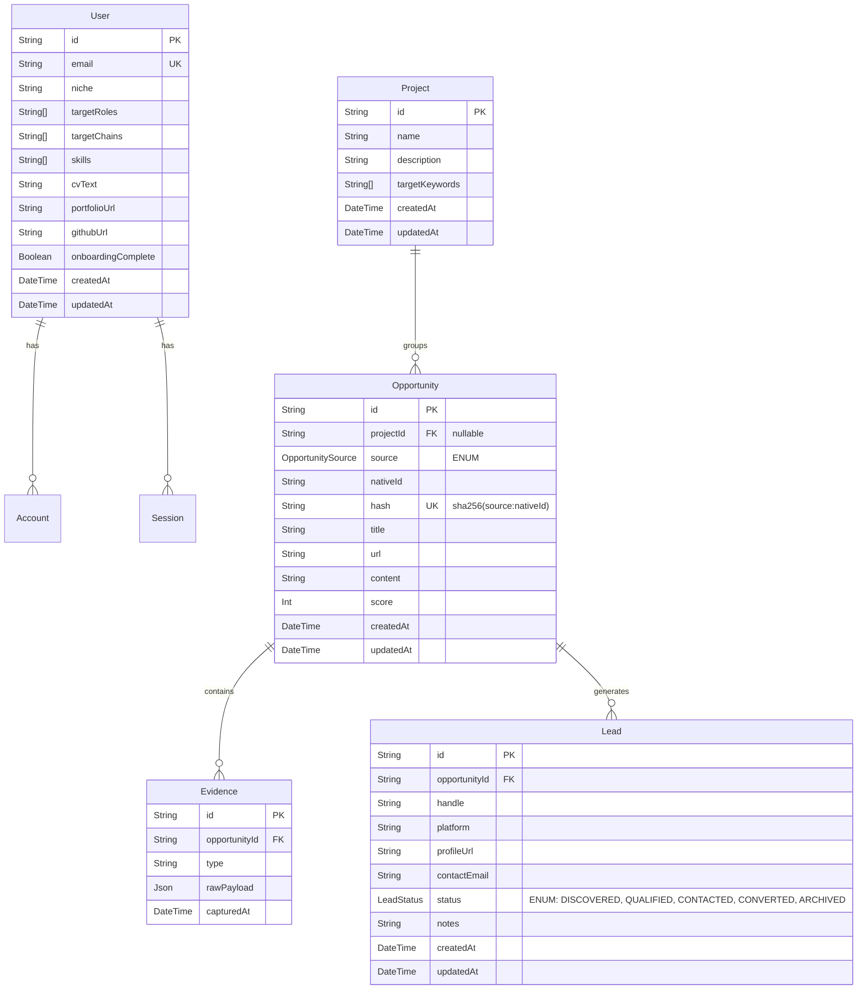
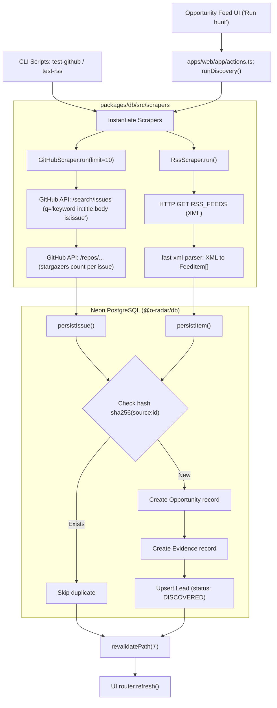
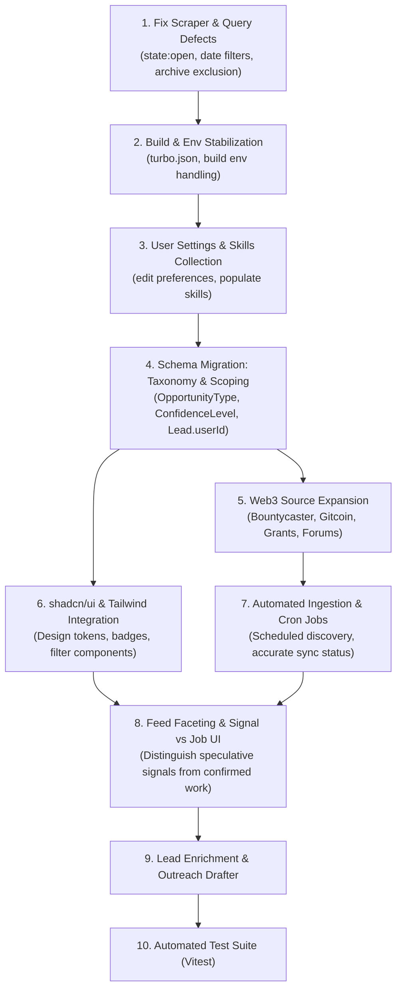

# O-Radar — Implementation Audit & Architectural Baseline

**Phase 0: Repository Audit and Implementation Plan**  
_Date: October 2026_
_Role: Senior Engineer / Web3 Opportunity Intelligence_

---

## 1. Executive Summary

O-Radar is architected as a pnpm Turborepo monorepo designed to help Web3 builders, designers, developers, and freelancers discover opportunities (jobs, bounties, grants, ecosystem programs, and early project signals) and manage them as actionable leads.

The existing codebase contains a functional proof-of-concept with authentication (NextAuth v5 beta + Google OAuth + Neon PostgreSQL via Prisma), two raw scrapers (GitHub Issue Search API and generic RSS XML parser), a feed dashboard, and a rudimentary lead management pipeline.

However, the application suffers from critical architectural and operational bottlenecks:

1. **Source & Data Quality Deficits**: The feed is flooded with stale, closed, non-Web3 GitHub issues (some years old) and irrelevant RSS articles due to unconstrained search queries, lack of recency filters, missing `state:open` checks, and overwriting issue creation dates with `now()`.
2. **Missing Opportunity Categorization**: No distinction exists between confirmed jobs/bounties/grants and speculative early-stage hiring signals.
3. **Global Unscoped Data**: Opportunities and leads are global in the database—leads and pipeline statuses are not scoped per user.
4. **Broken Workflow Feedback**: Archiving an opportunity marks a lead as `ARCHIVED` in the database, but the feed query never excludes archived opportunities, leaving them visible permanently.
5. **No Automated Ingestion**: Ingestion only triggers via manual "Run hunt" clicks in the browser or terminal test scripts; there are no crons, workers, or webhooks.
6. **Build & Environment Sensitivity**: Build pipelines fail when `GITHUB_PAT` is not provided to Next.js static collection for `/api/health`, and `GITHUB_PAT` is omitted from Turborepo `globalEnv`.
7. **Unconfigured Design System**: The shared `@repo/ui` package contains unused Turborepo boilerplate; `apps/web` relies on bespoke CSS variables and lacks Tailwind CSS, path aliases (`@/*`), and shadcn/ui.

---

## 2. Monorepo Architecture & Directory Structure

### 2.1 Workspace Configuration

- **Package Manager**: `pnpm@11.25.0` (with workspace configuration in `pnpm-workspace.yaml`).
- **Node Engine**: `>=24` (currently running on Node `v24.19.0`).
- **Turborepo**: `v2.11.9` (`turbo.json`).
- **TypeScript**: Shared base configuration with `ES2022` target and `NodeNext` resolution in packages, `ESNext`/`Bundler` in Next.js.
- **Linters & Formatters**: ESLint 10.9.1 (`eslint.config.js` flat configs), Prettier 3.9.6.

### 2.2 Directory Layout

```
o-radar/
├── AGENTS.md                          # Turborepo agent guidance rule
├── package.json                       # Root scripts (build, dev, lint, format, check-types)
├── pnpm-lock.yaml                     # Lockfile
├── pnpm-workspace.yaml                # Workspace package declarations (apps/*, packages/*)
├── turbo.json                         # Turborepo task definitions and globalEnv
├── scripts/
│   ├── test-github-scraper.ts         # Direct execution script for GitHub scraper (tsx)
│   └── test-rss-scraper.ts            # Direct execution script for RSS scraper (tsx)
├── packages/
│   ├── db/                            # @o-radar/db shared database & scraper package
│   │   ├── package.json
│   │   ├── tsconfig.json
│   │   ├── prisma/
│   │   │   └── schema.prisma          # PostgreSQL models (Neon hosted)
│   │   └── src/
│   │       ├── index.ts               # PrismaClient singleton initialization
│   │       └── scrapers/
│   │           ├── github.ts          # GitHub Issue API scraper & scorer
│   │           └── rss.ts             # XML RSS/Atom parser & scorer
│   ├── eslint-config/                 # Shared ESLint flat configurations
│   ├── typescript-config/             # Shared tsconfigs (base.json, nextjs.json, react-library.json)
│   └── ui/                            # @repo/ui shared component package (starter boilerplate)
│       ├── package.json
│       └── src/
│           ├── button.tsx             # Boilerplate button with window.alert
│           ├── card.tsx               # Boilerplate card with Turborepo links
│           └── code.tsx               # Boilerplate code tag
└── apps/
    └── web/                           # Next.js 16.3.8 web application
        ├── package.json
        ├── next.config.js             # Standard Next.js config
        ├── tsconfig.json              # Extends @repo/typescript-config/nextjs.json (no path aliases)
        ├── auth.ts                    # NextAuth v5 beta config (PrismaAdapter, Google OAuth)
        ├── src/
        │   ├── env.ts                 # Zod validation for runtime environment
        │   ├── require-user.ts        # Server-side auth & onboarding guard
        │   └── lib/
        │       └── match-opportunity.ts # (Working tree) Profile matching calculation
        └── app/
            ├── layout.tsx             # Root HTML layout with Geist font definition
            ├── globals.css            # Custom CSS token definitions and app styles
            ├── page.tsx               # Feed dashboard (Server component)
            ├── actions.ts             # Server actions (runDiscovery, promote, archive, leads)
            ├── components/
            │   ├── dashboard-header.tsx  # Top navigation bar
            │   ├── opportunity-feed.tsx  # Feed cards, drawer, search, hunt trigger
            │   └── lead-table.tsx        # Pipeline table with status and notes
            ├── api/
            │   ├── auth/[...nextauth]/route.ts # NextAuth HTTP handler
            │   └── health/route.ts             # Health check endpoint (checks Prisma connection)
            ├── signin/page.tsx        # Authentication landing page
            ├── onboarding/
            │   ├── page.tsx           # Setup form for niche, target roles, chains, CV
            │   └── actions.ts         # completeOnboarding action
            ├── leads/page.tsx         # Tracked leads management page
            └── settings/page.tsx      # Read-only connection status display
```

---

## 3. Database Models & Schema Relationships

The database is managed via Prisma (`packages/db/prisma/schema.prisma`) targeting PostgreSQL on Neon.

### 3.1 Entity Relationship Diagram



### 3.2 Key Schema Observations & Vulnerabilities

1. **No User Scoping on Opportunities or Leads**:
   - `Opportunity` has no `userId` or tenant reference.
   - `Lead` has no `userId` reference.
   - Consequently, all users see the exact same global leads in `/leads`. If User A changes a lead status to `CONTACTED` or adds notes, it mutates globally for all users.
2. **Missing Opportunity Type Taxonomy**:
   - Opportunities only have `source` (`GITHUB_ISSUE`, `GITHUB_DISCUSSION`, `ECOSYSTEM_FORUM`, `RSS_FEED`, `CUSTOM_SCRAPER`).
   - There is no field indicating the **opportunity nature**: `JOB`, `BOUNTY`, `GRANT`, `HACKATHON`, `RF_CONTRIBUTOR`, or `SIGNAL`.
3. **Compensation & Classification Fields Missing**:
   - No fields for compensation (`rewardAmount`, `currency`, `salaryMin`, `salaryMax`), contract type (`full-time`, `part-time`, `gig`, `bounty`), or deadline/expiry.
4. **No Prisma Migrations Directory**:
   - The repository has no `packages/db/prisma/migrations/`.
   - The database was initialized and synchronized using `prisma db push`. Production workflows should move to standard migrations when schema changes are introduced.

---

## 4. Current Ingestion Pipeline & Source Inventory

### 4.1 Ingestion Flowchart



### 4.2 Source Inventory

| Source Identifier   | Implementation File                  | Method & API Endpoint                                                         | Default Queries / Feeds                                                                                                              | Authentication                                                       |
| :------------------ | :----------------------------------- | :---------------------------------------------------------------------------- | :----------------------------------------------------------------------------------------------------------------------------------- | :------------------------------------------------------------------- |
| `GITHUB_ISSUE`      | `packages/db/src/scrapers/github.ts` | REST: `GET https://api.github.com/search/issues` + `GET issue.repository_url` | 6 static keywords: `"looking for designer"`, `"grant proposal"`, `"bounty"`, `"smart contract audit"`, `"frontend"`, `"UI overhaul"` | Optional `GITHUB_PAT` header (defaults to 60 req/hr unauthenticated) |
| `RSS_FEED`          | `packages/db/src/scrapers/rss.ts`    | HTTP GET + `fast-xml-parser`                                                  | Reads comma-separated URLs from `RSS_FEEDS` env                                                                                      | None                                                                 |
| `GITHUB_DISCUSSION` | Enum only (`schema.prisma`)          | _Not implemented_                                                             | N/A                                                                                                                                  | N/A                                                                  |
| `ECOSYSTEM_FORUM`   | Enum only (`schema.prisma`)          | _Not implemented_                                                             | N/A                                                                                                                                  | N/A                                                                  |
| `CUSTOM_SCRAPER`    | Enum only (`schema.prisma`)          | _Not implemented_                                                             | N/A                                                                                                                                  | N/A                                                                  |

---

## 5. Matching & Scoring Analysis

### 5.1 Ingestion-Time Signal Scoring

Both scrapers compute a coarse, static integer score ($0 - 100$) saved into `Opportunity.score`:

1. **GitHub Scoring** (`github.ts#L223-L229`):

   ```ts
   const matches = this.keywords.filter((keyword) =>
     content.includes(keyword.toLowerCase()),
   );
   const explicitIntent =
     /(looking for|hiring|grant|bounty|audit|need help)/i.test(content);
   return Math.min(100, matches.length * 15 + (explicitIntent ? 25 : 0));
   ```
   - _Flaw_: Every occurrence of generic words like "frontend" or "UI overhaul" in an issue description inflates the score by 15 points, regardless of whether the issue is a bug report, documentation task, or already resolved.

2. **RSS Scoring** (`rss.ts#L201-L207`):
   ```ts
   const intentMatches = [
     "grant",
     "bounty",
     "hiring",
     "looking for",
     "job",
     "contributor",
     "audit",
   ].filter((keyword) => content.includes(keyword));
   return Math.min(100, intentMatches.length * 15 + (item.author ? 10 : 0));
   ```
   - _Flaw_: A news article discussing "The Ethereum Foundation grant recipient..." gets full intent score matches despite offering no actionable opportunity.

### 5.2 User Profile Personalization & Onboarding Fields

The user profile in `prisma.user` contains:

- `niche`: string (e.g., "Product design for early-stage Web3 teams")
- `targetRoles`: string array (selected from: "Product / UI design", "Frontend development", "Community & growth", "Content & brand", "Research & strategy")
- `targetChains`: string array (selected from: "Solana", "Ethereum", "Base", "Arbitrum", "Stacks", "Multichain")
- `skills`: string array (**never collected** during onboarding; remains empty `[]`)
- `cvText`: text (freeform resume / services summary)
- `portfolioUrl` & `githubUrl`: optional URLs

#### Profile Matching Status:

- **In Main Branch (`origin/main`)**: The user profile is **completely ignored**. `apps/web/app/page.tsx` queries `prisma.opportunity.findMany({ orderBy: [{ score: "desc" }, { createdAt: "desc" }], take: 30 })` and presents the exact same feed to every user.
- **In Working Tree (`apps/web/src/lib/match-opportunity.ts`)**: An unstaged in-memory scoring function evaluates:
  - Target roles: $+20$ pts per match (max 35).
  - Target chains: $+12$ pts per match (max 20).
  - Skills: $+10$ pts per match (max 25) — _ineffective because `skills` is never populated_.
  - Niche: $+10$ pts for substring match.
  - CV text: $+5$ pts per matched keyword (max 10).
  - Global signal quality: $+10\%$ bonus from `opportunity.score`.

---

## 6. Existing Routes & UI Components

### 6.1 Routes

| Route                     | Component File                                 | Auth Guard                                                                     | Server Actions / Ingestion Calls                                 | Data Operations                                                         |
| :------------------------ | :--------------------------------------------- | :----------------------------------------------------------------------------- | :--------------------------------------------------------------- | :---------------------------------------------------------------------- |
| `/`                       | `apps/web/app/page.tsx`                        | `requireOnboardedUser()`                                                       | `runDiscovery`, `promoteOpportunityToLead`, `archiveOpportunity` | Queries 30 (or 200) opportunities ordered by score & date               |
| `/leads`                  | `apps/web/app/leads/page.tsx`                  | `requireOnboardedUser()`                                                       | `updateLeadStatus`, `updateLeadNotes`                            | Queries all `Lead` records ordered by `updatedAt desc`                  |
| `/onboarding`             | `apps/web/app/onboarding/page.tsx`             | Redirects to `/signin` if no session; redirects to `/` if `onboardingComplete` | `completeOnboarding`                                             | Updates `User` record with preferences, sets `onboardingComplete: true` |
| `/settings`               | `apps/web/app/settings/page.tsx`               | `requireOnboardedUser()`                                                       | None                                                             | Read-only static display of DB, GitHub, and environment status          |
| `/signin`                 | `apps/web/app/signin/page.tsx`                 | None                                                                           | NextAuth `signIn("google", ...)`                                 | Authenticates via Google OAuth                                          |
| `/api/health`             | `apps/web/app/api/health/route.ts`             | None                                                                           | None                                                             | Validates `prisma.$queryRawSELECT 1`                                    |
| `/api/auth/[...nextauth]` | `apps/web/app/api/auth/[...nextauth]/route.ts` | Managed by Auth.js                                                             | NextAuth HTTP handlers                                           | Session & OAuth callbacks                                               |

### 6.2 UI Components & Styling

1. **Dashboard Header** (`apps/web/app/components/dashboard-header.tsx`):
   - Navigation links to Feed (`/`), Leads (`/leads`), and Settings (`/settings`).
   - Hardcoded indicator: `<Activity size={14} /> <span>Synced 2m ago</span>`.
2. **Opportunity Feed** (`apps/web/app/components/opportunity-feed.tsx`):
   - Search input (filters in-memory by title substring).
   - Source selector (`all`, `github`, `rss`).
   - "Run hunt" button calling `runDiscovery(source)`.
   - Card actions: external link, "Promote" (creates lead), and "Archive" (creates archived lead).
   - Evidence drawer showing raw payload and content body.
3. **Lead Table** (`apps/web/app/components/lead-table.tsx`):
   - Displays contact handle, platform, source opportunity title/link, status dropdown (`DISCOVERED`, `QUALIFIED`, `CONTACTED`, `CONVERTED`, `ARCHIVED`), and contextual notes input with save button.
4. **Shared UI Package** (`packages/ui`):
   - Currently contains boilerplate Turborepo template components (`Button`, `Card`, `Code`). None are used in `apps/web`.
5. **Styling**:
   - `apps/web/app/globals.css`: 180+ lines of vanilla CSS using custom CSS variables (`--bg`, `--surface`, `--accent`, `--line`, etc.).
   - No Tailwind CSS, PostCSS, or CSS-in-JS library is installed.

---

## 7. Root Causes of the Poor Discovery Experience

The current feed is dominated by stale GitHub issues and irrelevant RSS entries due to 6 concrete code-level defects:

### 7.1 Defect 1: GitHub Search Query Lacks Status, Recency, and Web3 Scoping

_Code Reference_: `packages/db/src/scrapers/github.ts:L112-L118`

```ts
private async searchIssues(keyword: string, perPage: number) {
  const url = new URL("/search/issues", GITHUB_API_URL);
  url.searchParams.set("q", `${keyword} in:title,body is:issue`);
  url.searchParams.set("per_page", String(Math.min(Math.max(perPage, 1), 100)));
  return this.getJson<GitHubSearchResponse>(url);
}
```

- **Consequence**: The query does NOT include `state:open`. Closed, resolved, or abandoned issues from 2018–2022 are fetched.
- **Consequence**: The query does NOT include a date constraint (e.g. `created:>2026-09-01`).
- **Consequence**: The query is unconstrained across all of GitHub. Searching for `"frontend"` or `"UI overhaul"` returns generic non-Web3 repositories (React tutorial projects, personal blogs, unrelated open-source tools).

### 7.2 Defect 2: Ingested GitHub Issues Overwrite Creation Dates with `now()`

_Code Reference_: `packages/db/src/scrapers/github.ts:L180-L190`

```ts
const opportunity = await this.prisma.opportunity.create({
  data: {
    source: SOURCE,
    nativeId,
    hash,
    title: issue.title,
    url: issue.html_url,
    content: issue.body ?? "",
    score: this.calculateScore(issue),
    // NOTE: createdAt is omitted!
  },
});
```

- **Consequence**: `Opportunity.createdAt` in `schema.prisma` defaults to `@default(now())`. An issue originally created 4 years ago receives `createdAt = now()`.
- In the feed (`page.tsx:L36`), items are sorted by `score desc, createdAt desc`. These antique issues appear as brand new items ("12m ago") at the top of the feed.

### 7.3 Defect 3: Linear Stargazer Calls Exhaust GitHub API Rate Limits

_Code Reference_: `packages/db/src/scrapers/github.ts:L81-L87`, `L168`

```ts
const repositoryStars = await this.getRepositoryStars(issue.repository_url);
```

- **Consequence**: For every issue discovered across all 6 keywords, the scraper executes an additional HTTP request to the GitHub repository endpoint.
- Without a `GITHUB_PAT`, GitHub's unauthenticated IP rate limit is 60 requests per hour. A single "hunt" run immediately triggers `403 rate limit exceeded`, causing ingestion to fail for subsequent items.

### 7.4 Defect 4: Archived Opportunities Are Never Excluded from the Feed

_Code Reference_: `apps/web/app/actions.ts:L85-L107` vs `apps/web/app/page.tsx:L33-L43`

- In `actions.ts`: When a user clicks "Archive", `archiveOpportunity()` creates or updates a `Lead` record with `status = "ARCHIVED"`.
- In `page.tsx`:
  ```ts
  const opportunities = await prisma.opportunity.findMany({
    orderBy: [{ score: "desc" }, { createdAt: "desc" }],
    take: 30,
    include: { evidences: { orderBy: { capturedAt: "desc" }, take: 1 } },
  });
  ```
- **Consequence**: The feed query does not check or join `leads` to filter out opportunities marked as `ARCHIVED`. The user clicks "Archive", the button spins, the server action succeeds, but the card remains in the feed.

### 7.5 Defect 5: Generic RSS Ingestion Lacks Opportunity Filtering

_Code Reference_: `packages/db/src/scrapers/rss.ts:L201-L207`

- The RSS scraper treats any article containing words like "grant", "bounty", or "audit" as an opportunity.
- Informational blogs (e.g. general crypto news or protocol governance recaps) are persisted as opportunities. There is no classification mechanism to distinguish a news article from a hiring announcement or RFP.

### 7.6 Defect 6: Manual Triggering Only & Fake Sync Status

_Code Reference_: `apps/web/app/components/dashboard-header.tsx:L44`

```tsx
<span>Synced 2m ago</span>
```

- **Consequence**: There is no scheduled cron job or background worker. If no user manually triggers "Run hunt", no new data ever enters the system. The header's "Synced 2m ago" label is hardcoded text that misleads users into expecting background automation.

---

## 8. Phase 4 Discovery Pipeline Implementation

### 8.1 Integrated

- GitHub and RSS remain the only live adapters in this phase, but both now use shared normalization helpers and return `fetched`, `created`, `updated`, `skipped`, and `failed` counts.
- GitHub searches only open issues, rejects duplicate/resolved language and irrelevant issues, preserves repository/issue evidence, and no longer makes per-issue stargazer requests. Optional `GITHUB_PAT` is sent only when configured.
- RSS preserves feed identity and original URLs, rejects malformed entries, parses dates defensively, and never substitutes the ingestion time for a missing publication date.
- Existing records are updated by stable source/native-id hashes, so repeated runs refresh classification and stale state without creating duplicates.
- `OpportunityCategory`, `OpportunityConfidence`, `publishedAt`, `discoveredAt`, `isStale`, and `sourceQuality` distinguish confirmed jobs, bounties, grants, hackathons, contributor requests, and early signals.
- `SourceHealth` records per-source attempt/success times, counters, and bounded error text. Source failures are isolated with `Promise.allSettled`.
- `POST /api/ingest` is a secure ingestion entry point. It requires `Authorization: Bearer $INGESTION_SECRET`; a deployment cron or external scheduler must call it. A Next.js route does not schedule itself.

### 8.2 Source inventory

| Source                                     | Category coverage                              | Collection                        | Cost/auth                    | Frequency/status                                     | Limitations                                                                                 |
| ------------------------------------------ | ---------------------------------------------- | --------------------------------- | ---------------------------- | ---------------------------------------------------- | ------------------------------------------------------------------------------------------- |
| GitHub Issue Search API                    | Bounties, jobs, contributor requests, signals  | Official REST API                 | Free; optional `GITHUB_PAT`  | Manual action or secured ingest endpoint; integrated | Search API relevance is imperfect and public unauthenticated limits are low                 |
| Configured RSS/Atom feeds                  | Grants, jobs, programs, announcements, signals | Public feed URLs from `RSS_FEEDS` | Free; no auth                | Manual action or secured ingest endpoint; integrated | Feed quality, dates, and retention depend on operators; only configured feeds are collected |
| Official ecosystem job/grant/bounty pages  | Candidate expansion                            | Not integrated                    | To be evaluated per provider | Proposed                                             | No source is assumed to have an API; terms and structured access must be verified first     |
| Gitcoin, DoraHacks, official announcements | Candidate expansion                            | Not integrated                    | To be evaluated per provider | Proposed                                             | Requires current API/feed/terms verification before implementation                          |

### 8.3 Actual RSS staleness cause

The stale feed was caused by configuration and ingestion behavior together: `RSS_FEEDS` is empty or contains broad, low-signal feeds unless deployment environment variables are maintained, while the collector imported every valid article and scored keyword mentions as opportunities. It also used the parsed publication date as `Opportunity.createdAt`, leaving no separate discovery timestamp or stale state. The Phase 4 schema and normalization changes separate those timestamps, reject malformed/irrelevant records, update duplicates, and expose source health; operators still need to configure current feeds and schedule `/api/ingest`.

### 8.4 Not yet integrated

Gitcoin-related listings, DoraHacks events, ecosystem-specific job boards, grants portals, and public project hiring pages are inventory candidates only. They are intentionally not scraped until their current public API/feed support, terms, rate limits, and activity are verified. No paid service or private access is required by this MVP.

---

## 8. shadcn/ui Installation Considerations for this Repository

shadcn/ui has **not** been initialized in `apps/web` (no `components.json`). Installing it requires specific architectural accommodations:

### 8.1 Monorepo Placement

- **Option A (Recommended for Next Phase)**: Initialize shadcn directly in `apps/web`.
  - _Rationale_: All current UI routes, server actions, and domain components reside in `apps/web`.
- **Option B**: Initialize shadcn inside `packages/ui`.
  - _Rationale_: Makes components available across multiple apps (e.g., if a future admin app or documentation app is added).
  - _Complication_: Requires configuring Tailwind CSS, PostCSS, and React 19 exports across workspace boundaries.

### 8.2 Path Alias Configuration

`apps/web/tsconfig.json` currently does not define path mappings:

```json
// Current apps/web/tsconfig.json
{
  "extends": "@repo/typescript-config/nextjs.json",
  "compilerOptions": {
    "declaration": false,
    "declarationMap": false,
    "strictNullChecks": true
  }
}
```

- _Required Change_: Add `"baseUrl": "."` and `"paths": { "@/*": ["./*"] }` to `apps/web/tsconfig.json` to allow standard shadcn component imports (`@/components/ui/...`).

### 8.3 Tailwind CSS & CSS Architecture

- Currently, `apps/web` has no Tailwind dependency, `tailwind.config.ts`, or `postcss.config.mjs`.
- `apps/web/app/globals.css` defines custom dark-mode CSS variables:
  `--bg: #090a0f`, `--surface: #10121a`, `--accent: #3b82f6`, `--line: #1c2233`.
- _Requirement_: When installing Tailwind CSS (Tailwind v4 or v3) for shadcn, CSS variable names in `globals.css` must either map to shadcn's expected tokens (`--background`, `--foreground`, `--card`, `--primary`, `--border`, etc.) or be adapted so existing custom styles do not break.

### 8.4 React 19 Compatibility

- `apps/web` uses React `19.2.8` and `@types/react: 19.2.18`.
- Radix UI primitives and shadcn CLI components must be installed with compatible peer dependency resolutions in pnpm.

---

## 9. Missing Capabilities Grouped by Priority

### Priority 0: Critical Foundations & Defect Rectification

1. **Scraper Recency & Quality Guardrails**:
   - Scope GitHub search to `state:open`, `created:>YYYY-MM-DD`, and specific curated Web3 ecosystems/topics (`topic:ethereum`, `topic:solana`, etc.).
   - Persist original issue `created_at` timestamp as `Opportunity.createdAt`.
   - Remove per-issue linear repository HTTP queries or batch them to prevent rate limiting.
2. **Feed Archive Exclusion**:
   - Exclude opportunities with `leads.some(status == ARCHIVED)` from the feed query.
3. **Build & Environment Variable Fixes**:
   - Add `GITHUB_PAT` to `turbo.json` `globalEnv`.
   - Ensure `src/env.ts` handles build-time static page collection gracefully when external API keys are omitted.
4. **User-Scoped Leads**:
   - Add `userId` to `Lead` model to isolate user pipeline tracking.
5. **Settings Page Preference Editing**:
   - Allow users to update their niche, target roles, target chains, skills, and CV from `/settings` after onboarding.

### Priority 1: Web3 Opportunity Intelligence & Source Expansion

1. **Opportunity Nature & Confidence Taxonomy**:
   - Introduce an `OpportunityType` enum: `JOB`, `BOUNTY`, `GRANT`, `HACKATHON`, `RF_CONTRIBUTOR`, `PROJECT_SIGNAL`.
   - Introduce a `ConfidenceLevel` enum: `CONFIRMED` (verified posting) vs `SPECULATIVE` (inferred signal).
   - Display distinct visual badges in the UI so speculative signals are never confused with confirmed jobs.
2. **Dedicated Web3 Ingestion Sources**:
   - Web3 Bounties: Bountycaster (Farcaster/base bounties), Gitcoin, Superteam Earn.
   - Web3 Grants: Gitcoin Grants, Optimism RPGF, Arbitrum/Solana foundation grant RFP trackers.
   - Web3 Job Boards: Specialized Web3 boards (CryptoJobsList, Web3.career RSS/APIs).
   - Ecosystem Governance Forums: Discourse RSS/APIs for DAO proposals and contributor requests (Uniswap, Aave, Arbitrum, MakerDAO).
3. **Background Synchronization**:
   - Implement scheduled ingestion (via Next.js cron route, Vercel cron, or background worker) with real timestamp recording for the "Synced" badge.
4. **Structured Skill Capture**:
   - Add skill tagging to onboarding and settings so `MatchingProfile.skills` is actively matched.

### Priority 2: Workflow & Conversion Tools

1. **Compensation & Bounty Metadata**:
   - Extract and display structured reward amounts (e.g. "$2,500 USDC", "0.5 ETH", "$120k-$150k").
2. **Outreach & Research Drafter**:
   - In-drawer research assistant: generate customized outreach pitches referencing the user's CV, matching skills, and the project's evidence payload.
3. **Advanced Filtering & Search**:
   - Faceted filters on feed: Filter by Type (Job, Bounty, Grant, Signal), Chain (Ethereum, Solana, Base, etc.), and Compensation Range.
4. **Comprehensive Automated Testing**:
   - Setup Vitest / Testing Library for scraper parsers, scoring calculations, and matching algorithms.

---

## 10. Recommended Implementation Sequence & Dependencies



### Phase Dependencies

1. **Foundation First**: Scraper query fixes, archive filtering, and build stability must be deployed before expanding sources, or newly added sources will inherit the same pipeline bugs.
2. **Schema Migration before Source Expansion**: The schema must support `OpportunityType` (`JOB`, `BOUNTY`, `GRANT`, `SIGNAL`) and `ConfidenceLevel` (`CONFIRMED`, `SPECULATIVE`) before writing parsers for new sources so data is stored correctly from day one.
3. **UI Infrastructure before Feed Overhaul**: Configuring Tailwind and shadcn allows new faceted filters, badges, and drawers to be built cleanly without expanding custom CSS technical debt.

---

## 11. Environment Variables & Consumption Map

| Variable Name          | Required At        | Consumed In                                                   | Purpose                                                            | Exposure / Security                                    |
| :--------------------- | :----------------- | :------------------------------------------------------------ | :----------------------------------------------------------------- | :----------------------------------------------------- |
| `DATABASE_URL`         | Runtime & Build    | `packages/db/prisma/schema.prisma`<br>`apps/web/src/env.ts`   | PostgreSQL connection string (Neon hosted)                         | Server-side only. Must never be exposed to client.     |
| `GITHUB_PAT`           | Runtime (Optional) | `packages/db/src/scrapers/github.ts`<br>`apps/web/src/env.ts` | GitHub Personal Access Token for higher rate limits (5,000 req/hr) | Server-side only. Missing in `turbo.json` `globalEnv`. |
| `RSS_FEEDS`            | Runtime (Optional) | `packages/db/src/scrapers/rss.ts`                             | Comma-separated list of RSS/Atom feed URLs                         | Server-side only. Tracked in `turbo.json` `globalEnv`. |
| `AUTH_SECRET`          | Runtime            | `apps/web/auth.ts`<br>`apps/web/src/env.ts`                   | NextAuth encryption secret (32+ chars)                             | Server-side only. Tracked in `turbo.json` `globalEnv`. |
| `GOOGLE_CLIENT_ID`     | Runtime            | `apps/web/auth.ts`<br>`apps/web/src/env.ts`                   | Google Cloud OAuth Client ID                                       | Server-side only. Tracked in `turbo.json` `globalEnv`. |
| `GOOGLE_CLIENT_SECRET` | Runtime            | `apps/web/auth.ts`<br>`apps/web/src/env.ts`                   | Google Cloud OAuth Client Secret                                   | Server-side only. Tracked in `turbo.json` `globalEnv`. |
| `AUTH_URL`             | Runtime            | Turborepo / NextAuth internal                                 | Canonical application URL for OAuth redirects                      | Server-side only. Tracked in `turbo.json` `globalEnv`. |
| `NODE_ENV`             | Build & Runtime    | `apps/web/auth.ts`<br>`packages/db/src/index.ts`              | Node runtime environment (`development`, `production`, `test`)     | Standard system variable.                              |

---

## 12. Verification & Validation Commands

The following commands verify the audit findings and workspace health:

```bash
# 1. Verify TypeScript types across all workspace packages
pnpm run check-types

# 2. Verify ESLint rules across all workspace packages
pnpm run lint

# 3. Test GitHub scraper dry-run (verifies API integration)
pnpm --filter @o-radar/db test:github

# 4. Test RSS scraper dry-run (verifies XML parsing)
pnpm --filter @o-radar/db test:rss

# 5. Inspect Git status and existing uncommitted working tree modifications
git status -s
```
